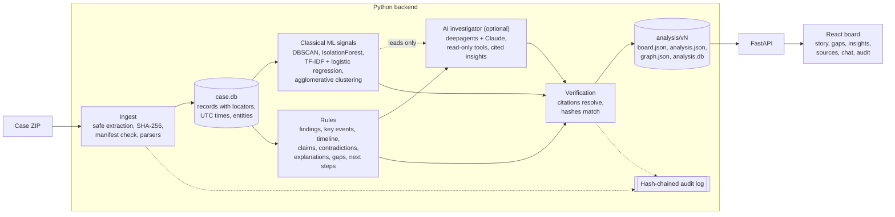

<p align="center">
  <a href="https://mapletrace.work">
    <picture>
      <source media="(prefers-color-scheme: dark)" srcset="frontend/public/mapletrace-mark.svg">
      <source media="(prefers-color-scheme: light)" srcset=".github/assets/mapletrace-logo-tile.svg">
      
    </picture>
  </a>
</p>

<h1 align="center">MapleTrace</h1>

<p align="center">
  <strong>Evidence, connected. Reasoning, defensible.</strong><br>
  Turn a ZIP of mixed case evidence into an inspectable evidence board where every thread cites the exact file and row it came from.
</p>

<p align="center">
  <a href="https://mapletrace.work"><strong>Try the live demo at mapletrace.work &rarr;</strong></a>
</p>

<p align="center">
  <a href="#the-three-minute-demo">Demo walkthrough</a> &middot;
  <a href="#how-it-works">How it works</a> &middot;
  <a href="#what-makes-it-different">What makes it different</a> &middot;
  <a href="#quick-start">Quick start</a> &middot;
  <a href="#docs">Docs</a>
</p>

> [!NOTE]
> MapleTrace is a HackPrinceton Fall 2026 prototype. All case data is fictional, and the live site has no accounts or authentication, so upload fictional data only.

## What it is

Investigations drown in heterogeneous evidence: badge logs, phone exports, location history, CCTV, photos, emails, interview transcripts and lab reports, each with its own format, clock and time zone. MapleTrace ingests the whole bundle without altering it, normalizes every record to UTC with explicit uncertainty, and builds an evidence board of people, devices, events, places and statements.

Rules, classical machine learning and an AI agent then point out contradictions, gaps and the evidence worth requesting next. Every card, thread and insight links back to its original source, observed facts stay visibly separate from inference, and a hash-chained audit trail records every step.

## The three-minute demo

The demo case is **Kestrel**: a fictional theft of an unreleased GPU engineering sample from a secure cabinet at a fictional chip company. It has 57 files across 14 modalities (access logs, CDRs, location history, calendar, photos, CCTV video, emails, interviews, written statements, DNA and lab reports).

1. **Open the case.** On [mapletrace.work](https://mapletrace.work), press **Explore demo case**. It opens a finished analysis from a committed snapshot, so it is instant and makes no model calls.
2. **Watch the run replay.** The board starts empty and grows as the recorded run plays back: files are hashed and parsed, then rules, ML and the agent add their findings. A HUD shows each stage, with 1x, 10x and 50x speeds, pause and skip.
3. **Read the key finding.** The board opens on a compact story of the leading key event and the cards around it. The **Key finding** tab shows a contradiction: one person's statement that he was "at home, a quiet night" against dozens of location and access records from the same window. It lists several possible reasons (a shared credential, a time-zone assumption, a phone away from its owner, or an untrue statement as one option among them) and a note that this is not proof.
4. **Inspect a source.** Click any thread label or card arrow. The review dock shows the cited excerpts, and **Raw evidence** opens the original file scrolled to the highlighted row or line.
5. **Review gaps and next evidence.** The **Gaps** and **Next evidence** tabs list the questions the data cannot answer (who was physically at the cabinet, who uses an unnamed phone number) and rank the evidence to request: CCTV export for the window, DNA and fingerprints, carrier location records, a phone extraction. Selecting one pans to the relevant cluster.
6. **Ask the case.** The chat answers suggested questions with cited observations, inference and unknowns kept apart, replaying the agent's tool calls.
7. **Check the audit trail.** **Audit trail** re-verifies the evidence hashes, the database hash and the hash chain from ingestion through analysis.

## How it works



### 1. Ingestion (`backend/mapletrace_ingest`)

- **Safe intake.** The archive is extracted with guards against path traversal, links, encrypted members and zip bombs. Every file is SHA-256 hashed before parsing and stored as a read-only working copy.
- **Manifest check.** When the bundle has a `MANIFEST.csv`, every listed hash is checked and each file gets its evidence ID (`EV-071`), owner and time basis. On Kestrel, all 57 files parse and all 56 manifest hashes match.
- **Format detection and parsing.** Formats are identified from content, not extensions, and each decision is stored with its score table and reason. One parser per evidence type handles CSV/JSON logs, CDRs, GPX, KML and Google location history, iCalendar, contacts, EML and mbox (attachments re-ingested), TXT/DOCX/PDF statements and interview transcripts, DNA and lab tables, photos (EXIF) and video and audio containers.
- **Normalized records.** About 5,600 records on Kestrel. Each carries a `locator` (row, line, page or JSON path) back into its file, a timestamp in UTC with an uncertainty window and a flag for every assumption (time zone assumed, day/month ambiguous, AM/PM inferred), and a reliability label: `recorded` (a machine logged it), `asserted` (a person said it) or `expert_finding` (a lab concluded it).
- **Entities.** People, phones, emails, devices and accounts are merged only on explicit evidence, such as a contact entry or an unambiguous name form, and every merge is stored with its rule and confidence.

### 2. Classical ML signals (`backend/mapletrace_reason/ml.py`)

Scikit-learn models with fixed seeds, learning only from the case's own evidence. They produce cited **leads**, never conclusions. Signals go to the board and to the agent as leads, but never into the rules stages, so ML can never change a finding, an explanation or a gap.

| Signal | Method |
| --- | --- |
| Likely home, work and recurring evening places | DBSCAN with the haversine metric on each person's location points |
| Days that break a person's routine | IsolationForest on per-day movement profiles |
| Automated or spam messages versus human ones | TF-IDF + logistic regression, weakly labelled by rules |
| Name forms that probably belong to one person | Character TF-IDF + agglomerative clustering, gated by name rules |

The rules stage separately fits an IsolationForest per log (each system has its own normal) to flag unusual events, explained by their features.

### 3. Rules and reasoning (`backend/mapletrace_reason`)

Deterministic stages that need no API key and finish in seconds:

- **Findings and key events:** co-location, unusual events, one person in two places at once, notable communication, grouped into key events weighted by how many independent systems recorded them.
- **Source independence:** repeated information (double exports, copied text, reports restating statements) is detected, so corroboration counts independent origins rather than records.
- **Claims and contradictions:** statements become structured claims with time windows and are checked against the records. Each contradiction lists the conflicting and consistent records, several possible reasons and the evidence that would resolve it.
- **Competing explanations:** each key event is scored against alternatives (present, someone else used the credential, an associate, a system error), and the verdict may be "insufficient evidence to choose".
- **Gaps and next evidence:** typed gaps (missing, failed extraction, conflicting, uncertain) and requests ranked by the gaps they close, how well they separate explanations, urgency and source independence.
- **Verification:** every citation must resolve to a record whose file hash still matches. Uncited items are dropped, accusatory wording is softened and protected attributes are stripped.

### 4. AI investigator (optional, `--llm`)

A [deepagents](https://github.com/langchain-ai/deepagents) agent on Claude (`claude-sonnet-5-5` by default) explores the analysis through read-only tools (`search_records`, `get_record`, `list_explanations`, `list_open_questions`, `list_ml_signals`) in an in-memory sandbox with no file system or shell. It can write only through two guarded tools: `record_insight` rejects insights without valid record IDs and caps confidence by the number of independent sources, and `answer_question` can mark a gap partially resolved but never resolved. A verifier subagent checks citations. Claude also extracts claims from statements and describes photos and video frames; image descriptions are labelled as inferred and stay on the media cards.

Model responses are recorded per archive hash in `backend/llm_cache/` and committed, so uploading the Kestrel ZIP replays the agent for free and without a key. The same applies to the case chat's suggested questions.

### 5. The workspace (`frontend/`)

- **Evidence board:** paper cards on a pannable canvas (React Flow) with a minimap, a colour per entity type, solid threads for observed links and dashed threads for inferences and claims. A **story view** opens on the cards that matter; **Full graph** shows everything.
- **Analysis dock:** key finding, gaps, insights and next evidence, each focusing the board on its cluster.
- **Insights:** questions, evidence (contradictions, observations, missing periods, uncertain times) and inferences, with each inference tagged by its origin (rules, ML, agent or LLM).
- **Raw evidence and generalized files:** the original files with the cited row highlighted, and the normalized records table.
- **Chat:** cited answers about the case, with the agent's tool calls replayed.
- **Audit trail:** the verified hash chain from ingestion through analysis.

## Where it's useful

The demo case is a corporate theft, but nothing in the pipeline is specific to policing. MapleTrace fits anyone who must reconcile many sources and defend each conclusion:

- **Investigators** (corporate security, insurance fraud, law enforcement) building a timeline from logs, phones and statements.
- **Journalists** cross-checking leaked documents, public records and interviews.
- **Compliance and incident-response teams** reconstructing who accessed what, and when, across badge, workstation and system logs.
- **Auditors and lawyers** who need every claim traced to a document, page or row.

## What makes it different

| | |
| --- | --- |
| **Every claim is cited** | Every card, thread, gap and insight cites `{evidence_id, locator}`, such as `EV-071 seq=40162`, and opens the original file at that row. Uncited items are dropped before they reach the board. |
| **Observed and inferred stay apart** | Certainty comes from the backend, not styling guesses: observed threads are solid, inferences long-dashed, claims short-dashed. Insights list cited observations separately from the inference drawn from them. |
| **Contradictions never conclude someone lied** | Each contradiction offers several possible reasons, with an untrue statement as only one of them. Explanations may return "insufficient evidence", and a gap is never treated as proof. |
| **Evidence is never altered** | Read-only copies, SHA-256 hashes checked against the manifest, and a hash-chained audit log that `verify` re-checks end to end. |
| **Honest about time** | Every timestamp is UTC with an uncertainty window and a flag for each assumption; human-reported times are kept as asserted, not recorded. |
| **Works without an API key** | Ingestion, rules and ML are deterministic. The AI layer only adds cited claims and insights on top. |
| **Recorded replays** | Model responses are committed per archive hash, so the demo and the Kestrel upload replay the full run, agent included, at no cost. Replay timing is labelled as recorded or estimated. |
| **Bias safeguards** | Protected attributes (such as an ID's issuing country or nationality) are never model features and never returned by the API. The Kestrel case contains a deliberate bias trap to test this. ML learns only from the case's own evidence, never from an answer key, and the repository holds none. |

## Tech stack

| Layer | Technologies |
| --- | --- |
| Frontend | React 19, TypeScript, Vite, TanStack Query, React Flow (`@xyflow/react`), Vitest, Bun 1.4.4 |
| API | FastAPI, Uvicorn |
| Ingestion | Python 3.12 (3.11+), SQLite, Pillow, hachoir, pypdf, python-docx, defusedxml, python-dateutil |
| Classical ML | NumPy, scikit-learn |
| AI layer | LangChain deepagents, `langchain-anthropic`, Claude (`claude-sonnet-5-5`) |
| Case data | A deterministic Python generator (uv, PEP 723) that builds the fictional Kestrel case byte for byte |
| Deployment | Docker Compose with Caddy (automatic HTTPS) on a Vultr VM, with daily backups to object storage |

## Repository layout

```
.
├── frontend/              React + Vite workspace (board, insights, evidence, chat)
│   ├── src/api/           CaseApi contract, live HTTP adapter, disposable mock adapter
│   ├── src/components/    board, layout, review dock, insights, evidence viewer, chat
│   ├── src/replay/        run replay from the backend trace
│   └── src/onboarding/    landing page and project manager
├── backend/
│   ├── mapletrace_ingest/ ZIP intake, parsers, time normalization, entities, audit chain
│   ├── mapletrace_reason/ ML signals, rules, contradictions, gaps, LLM investigator, chat
│   ├── mapletrace_api/    FastAPI service
│   ├── llm_cache/         recorded model responses (committed)
│   ├── demo/              finished Kestrel snapshot served by POST /demo
│   └── tests/             pytest suite, including a full Kestrel ingestion
├── generator/             deterministic generator for the fictional case
├── cases/kestrel/         generated evidence, MANIFEST.csv and the upload ZIP
├── scripts/               Vultr deployment and backups
├── compose.yaml           optional Docker setup
└── Makefile               every development target (make help)
```

## Quick start

Requires Bun 1.4.4, [uv](https://docs.astral.sh/uv/) and Python 3.12. From the repository root:

```sh
make frontend-install
make backend-install     # uv sync: backend/.venv from backend/uv.lock
make dev                 # API on 127.0.0.1:8000 and Vite on 127.0.0.1:5173
```

Open [localhost:5173](http://localhost:5173) and press **Explore demo case**. It opens the prepared Kestrel case instantly from a committed snapshot (`POST /demo`), including its recorded LLM results, with no API key. **Upload case ZIP** runs real analysis on a new archive; uploading `cases/kestrel/kestrel_case_upload.zip` replays the recorded LLM responses. `make backend-seed-kestrel` uploads Kestrel from the command line. Set `ANTHROPIC_API_KEY` only for new LLM analyses and free-typed chat questions.

`make help` lists every target. The main checks:

```sh
make frontend-test       # Vitest suite
make frontend-build      # type-check and build into frontend/dist/
make backend-test        # pytest, including a full Kestrel ingestion
make data-verify         # rebuild the case and check every file hash
```

The pipeline also runs from the command line, from `backend/`:

```sh
uv run python -m mapletrace_ingest ingest ../cases/kestrel/kestrel_case_upload.zip --out runs/kestrel
uv run python -m mapletrace_reason analyze runs/kestrel     # deterministic, no API key
uv run python -m mapletrace_ingest verify runs/kestrel      # re-check hashes and the audit chain
```

### Docker

Optional, and not needed for development. Requires Docker with Compose and a running daemon. Stop anything else on port 5173 first.

```sh
export ANTHROPIC_API_KEY=...   # optional
make docker-up                 # docker compose up --build -d
make docker-logs               # follow logs
make docker-down               # stop; case data is kept
```

Open [localhost:5173](http://localhost:5173). `compose.yaml` runs two services:

- **`backend`:** FastAPI on port 8000 inside the Compose network only, built from the repository root with `backend/Dockerfile` and run as a non-root user. The root `.dockerignore` is an allowlist (backend code, `backend/demo/`, `backend/llm_cache/` and the Kestrel upload ZIP).
- **`frontend`:** the production build with `VITE_API_BASE_URL=/api`, served by Caddy on `127.0.0.1:5173`. Caddy proxies `/api/` to the backend, stripping the prefix as Vite does, accepts requests up to 100 MiB and allows 600 seconds for backend response headers. It starts once the backend is healthy.

The demo button and the Kestrel upload work without a key. Case data lives in the `mapletrace-data` volume at `/data`; it survives `make docker-down` and is removed by `docker compose down -v`.

Compose reads `ANTHROPIC_API_KEY` (optional) and `MAPLETRACE_LLM_MODEL` (default `claude-sonnet-5-5`) from your shell or a git-ignored root `.env`; never commit keys. `MAPLETRACE_DATA`, `MAPLETRACE_MAX_UPLOAD_MB=100` and `MAPLETRACE_CORS` are set in `compose.yaml`. If you raise the upload limit, also raise `max_size` in `frontend/Caddyfile`.

For a mock-only frontend without a backend: `docker build --build-arg VITE_API_BASE_URL=mock -t mapletrace-mock frontend`, then `docker run --rm -p 127.0.0.1:5173:80 mapletrace-mock`.

The production deployment at [mapletrace.work](https://mapletrace.work) runs the same images on a Vultr VM; see [scripts/README.md](scripts/README.md).

## Docs

| File | Purpose |
| --- | --- |
| [AGENTS.md](AGENTS.md) | Rules and durable decisions for contributors and agents |
| [SPEC.md](SPEC.md) | Product specification (changes need user and team approval) |
| [frontend/README.md](frontend/README.md) | Frontend development, adapters, routes and structure |
| [frontend/DESIGN.md](frontend/DESIGN.md) | Design system: brand, tokens, board colours and components |
| [frontend/CHAT.md](frontend/CHAT.md) | Case chat HTTP contract |
| [backend/README.md](backend/README.md) | Ingestion, reasoning pipeline, LLM layer and cache, HTTP API |
| [backend/TRACE.md](backend/TRACE.md) | Run trace contract used by the replay |
| [backend/MEDIA.md](backend/MEDIA.md) | Photo and video evidence contract |
| [backend/LLM_COSTS.md](backend/LLM_COSTS.md) | Measured cost of an LLM analysis and estimated chat cost |
| [generator/README.md](generator/README.md) | Case generator and the rules for changing it |
| [generator/EVALUATION.md](generator/EVALUATION.md) | Known consistency issues in the generated case |
| [cases/kestrel/README.md](cases/kestrel/README.md) | The Kestrel case contents (generated) |
| [scripts/README.md](scripts/README.md) | Vultr deployment, backups and operations |

## Fictional data

Every person, company, phone number (555-01xx), licence plate, address, domain (`.example`) and record in this repository and on the live demo is invented. Any resemblance to real people or organizations is coincidental. The Kestrel case is generated deterministically by [`generator/`](generator/README.md); its answer key is not in the repository and is never shown to the model.

## HackPrinceton Fall 2026

MapleTrace was built at [HackPrinceton](https://www.hackprinceton.com/) Fall 2026.

<!-- TODO: add the submitted tracks and prizes, and links to the Devpost page and demo video. -->

**Team** (from the commit history):

- Ryan ([@meizuflux](https://github.com/meizuflux))
- Sujay Korada
- [KleefBellevue](https://github.com/KleefBellevue)
- [Crazycoder612](https://github.com/Crazycoder612)

<!-- TODO: confirm names, add GitHub links for Sujay Korada and any members without commits. -->

## License

No license has been chosen yet, so all rights are reserved by the authors by default.
<!-- TODO: add a LICENSE file if the team wants to open-source the project. -->
