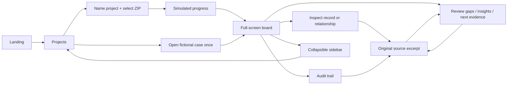

# Redesign workflow

The landing action opens projects (confirmed November 14, 2026).

- Projects keeps one entry for the mock adapter's one available case. Opening an existing entry resumes it; the fictional-case prompt disappears after entry.
- Upload has only ZIP selection, naming, simulated progress and opening the board. It has no duplicate case shortcut or size cap. It validates ZIP extension and nonempty metadata; it never reads or uploads contents.
- The canvas extends to all four edges; navigation, toolbar, legend, zoom/fit and minimap float above it. A desktop review dock preserves canvas dimensions, pan and zoom. Narrow layouts stack review below the board and scroll it into view.
- Search and list view provide a direct route to any record or relationship. All existing citations, uncertainty labels and illustrative score labels remain.
- Contact sales is removed until a real destination exists. No invented email or submission flow.
- CSS has one entry point and five concerns: global tokens/controls, workspace, evidence cards, review, upload. Onboarding owns its route styles and reuses shared controls. Avoid cascade patches and per-element utility classes.

## Image exploration

`workspace-concept.webp` was generated with the built-in imagegen tool as an exploratory full-screen board concept. It is not shipped in the app. Its generated faces, names, claims and text are not evidence or product truth. Only its canvas/overlay composition informed implementation; the app continues using disposable fixtures through the API adapter.

Prompt: “A full-bleed dark natural cork evidence pinboard with a compact moss toolbar, collapsible navigation, ivory evidence cards linked by rust threads, a source-first floating inspector, zoom/fit controls, legend and minimap. No marketing footer, breadcrumb, giant brand header, gradients or decorative AI pictograms.”

`src/assets/cork.webp` is the shipping background texture, generated with the built-in imagegen tool and converted to WebP at quality 82. It contains no evidence, labels or other case material.

Texture prompt: “A completely flat orthographic close-up of fine-grained dark warm brown natural cork, evenly and softly lit without gradients, vignettes, highlights, perspective, seams, framing, objects, pins, papers, or text. Muted low-contrast moss brown base around #66583f. Matte natural material; square repeatable texture with visually consistent edges.”
